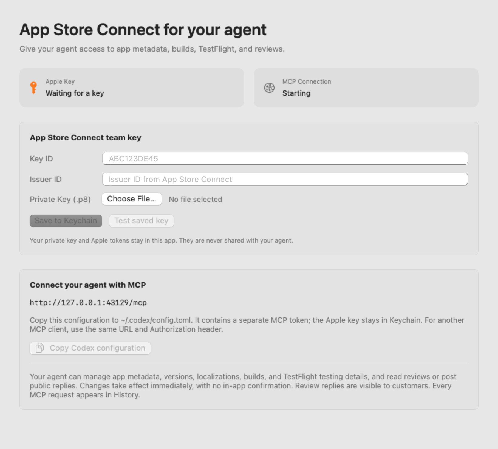

# ASC Bridge

A local macOS app that gives MCP clients typed access to App Store Connect while
keeping the Apple private key inside the app's Keychain-backed credential boundary.

[Polski](README.pl.md) · [Endpoint reference](docs/endpoints.md) ·
[Contributing](CONTRIBUTING.md) · [Localization](docs/localization.md) ·
[Security](SECURITY.md) · [MIT license](LICENSE)



The native interface uses English by default. Its text lives in Apple's String
Catalogs and is ready for additional translations. The MCP protocol and API
reference use English.

## What it does

- Exposes 23 tools for app/version discovery, localized App Store metadata, builds,
  TestFlight groups and What to Test text, and customer reviews and replies.
- Imports one App Store Connect team key through the native UI and stores it in
  macOS Keychain. Signs short-lived Apple JWTs internally.
- Serves Streamable HTTP at `http://127.0.0.1:43129/mcp`, authenticated with a
  separate local bearer token.
- Keeps sanitized MCP request history locally, including rejected requests and
  durable intent records before mutations.

Mutations execute immediately, without an app confirmation dialog. A client with
the local token can change metadata, attach a build or write a public review reply
within the Apple key's permissions. App submission/release, deletion, uploads,
analytics, credential tools and arbitrary HTTP/shell operations are outside the
current tool surface.

## Build and run

The app targets **macOS 14 or later**. Build with **Xcode 26.4 / Swift 6.3** and
**Python 3.9+**. These are the tested development tools; `Package.swift` declares
Swift tools 6.1, but that alone does not establish compatibility with older
compilers across the locked dependency graph. CI selects Xcode 26.4.1.

Clone this repository, open its directory, then run:

```sh
./scripts/build-app.sh
open "dist/ASC Bridge.app"
```

The script resolves the locked Swift packages, validates the third-party notices,
creates the app icon, bundles resources and license notices, and applies an ad-hoc
signature. It also supports `--debug`. The source-build workflow needs no Apple
Developer signing identity. This project does not currently provide a notarized
binary release or automatic updates.

## Connect an MCP client

1. Create or use an App Store Connect **team API key** with the permissions needed
   for your operations. Apple describes [creating API keys](https://developer.apple.com/documentation/appstoreconnectapi/creating-api-keys-for-app-store-connect-api).
2. In ASC Bridge, enter the Key ID and Issuer ID, select the `.p8` file, and click
   **Save to Keychain**.
3. Click **Test saved key**.
4. For Codex, use **Copy Codex configuration** and
   add the copied configuration to your client's local MCP settings. For another
   MCP client, select Streamable HTTP, use the endpoint above and the separate
   `Authorization` bearer value from the app's copied configuration.
5. Refresh MCP servers in your client or restart it.

The copied token authorizes the local broker; it is separate from the Apple key.
Keep the `.p8` and copied configuration out of the repository, issues and agent
conversations. The original `.p8` stays where you selected it; the app does not
remove it. The app must stay running. Closing the window keeps the server alive;
**⌘Q** stops it.

## Tools

| Tool | Purpose |
| --- | --- |
| `asc_list_apps` | Discover apps and resource IDs |
| `asc_get_app` | Read one app |
| `asc_list_versions` | List versions and their states |
| `asc_get_version` | Read one version |
| `asc_create_version` | Create a version with manual release policy |
| `asc_list_localizations` | Read localized version metadata |
| `asc_create_localization` | Add a version locale |
| `asc_update_localization` | Edit description, What's New, promotional text, keywords and URLs |
| `asc_list_app_infos` | Discover App Info records and states |
| `asc_list_app_info_localizations` | Read localized app names, subtitles and privacy metadata |
| `asc_create_app_info_localization` | Add an App Info locale |
| `asc_update_app_info_localization` | Edit localized App Info metadata |
| `asc_list_builds` | Filter builds by platform, number, marketing version and processing state |
| `asc_get_build` | Read one build |
| `asc_get_version_build` | Read a version's attached build |
| `asc_set_version_build` | Attach an existing build to a version |
| `asc_list_beta_groups` | Read TestFlight group summaries |
| `asc_list_beta_build_localizations` | Read localized What to Test text |
| `asc_create_beta_build_localization` | Add a TestFlight build locale |
| `asc_update_beta_build_localization` | Edit What to Test text |
| `asc_list_customer_reviews` | Filter and sort customer reviews |
| `asc_get_customer_review_response` | Read the developer response to a review |
| `asc_upsert_customer_review_response` | Create or replace a public developer reply |

Lists use bounded pagination. Apple's role and editable-state rules still apply.
App Info and version locales must match; they are managed in separate calls.
Attaching a build does not submit the app. Review replies are public, replace any
existing reply, and can take time to appear in the App Store. See the
[endpoint reference](docs/endpoints.md) for exact arguments, limits and Apple routes.

Example prompts:

> Find my app and show the editable iOS version and its existing localizations.

> Add matching Polish App Info and version locales, then set the name, subtitle,
> description and keywords. Read the existing metadata first.

> List the latest valid iOS builds and attach the build I select to version 1.2.0.

> Show the latest one-star reviews from Poland and read the existing developer replies.

## Local history and security

The **MCP History** tab shows methods, tools, parameters, timing, results and
failures. The app stores owner-only JSONL history under:

```text
~/Library/Application Support/ASCBridge/history.jsonl
```

The UI shows the latest 500 entries; the full local file remains on disk. Metadata
and reply text can appear in the history. Private keys, authorization headers and
JWT-like values are sanitized. If intent cannot be persisted, the request is not
dispatched. An unfinished entry can represent an interrupted mutation: check Apple
before repeating it. Apple mutations are never automatically retried.

Ad-hoc rebuilds can trigger a macOS Keychain prompt because the app's code identity
changed. To use a stable signing identity already installed on your Mac:

```sh
ASC_BRIDGE_SIGN_IDENTITY="Developer ID Application: Your Name (TEAMID)" ./scripts/build-app.sh
```

This does not notarize the app. The broker is not an isolation boundary against a
fully privileged process or an agent that can modify its executable. Read the
[security boundary](docs/security.md) and [reporting policy](SECURITY.md).

## Development

```sh
./scripts/check.sh
./scripts/build-app.sh --debug
python3 scripts/smoke-mcp.py "dist/ASC Bridge.app/Contents/MacOS/ASCBridge"
```

The checks use generated keys and stubbed Apple HTTP. The explicit `--smoke-server`
harness uses port 43130 and temporary history, never a real Keychain or Apple account.

The project uses SwiftPM: `BridgeCore` implements contracts, credentials and Apple
requests; `BridgeMCP` implements tools, transport and audit; `ASCBridge` composes the
SwiftUI app. The [localization guide](docs/localization.md) explains the native
String Catalog workflow. Start with [ARCHITECTURE.md](ARCHITECTURE.md),
[CONTRIBUTING.md](CONTRIBUTING.md) and the [changelog](CHANGELOG.md).

For maintainer setup and the first public push, see [Publishing](docs/publishing.md).

## License and acknowledgements

ASC Bridge's own code, original app icon and documentation are available under the
[MIT license](LICENSE). Dependencies retain their upstream licenses; exact notices
for the pinned versions are in [THIRD_PARTY_NOTICES.md](THIRD_PARTY_NOTICES.md) and
are included in the built app. Regenerate them after dependency changes with
`python3 scripts/update-third-party-notices.py`.

ASC Bridge is an independent project and is not affiliated with or endorsed by
Apple, OpenAI or the Model Context Protocol maintainers.
